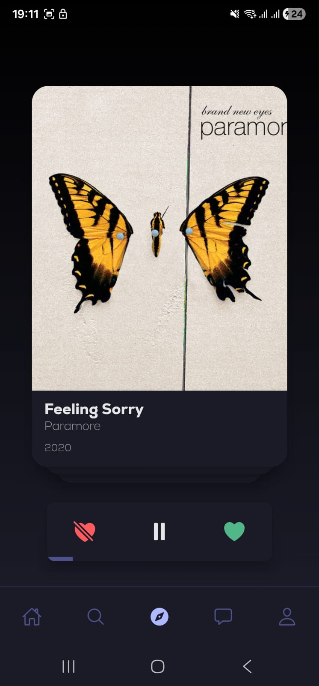
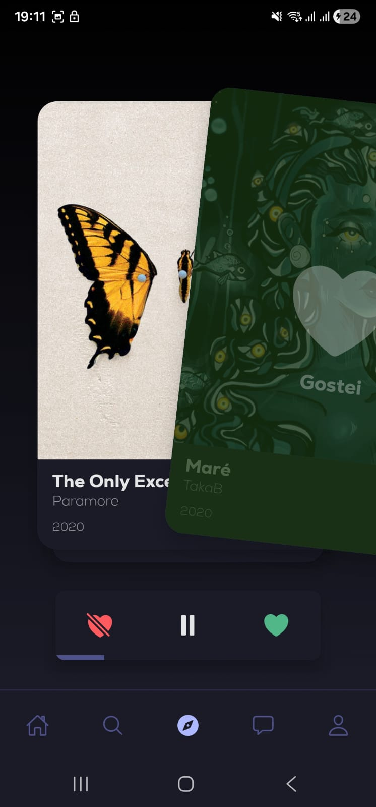
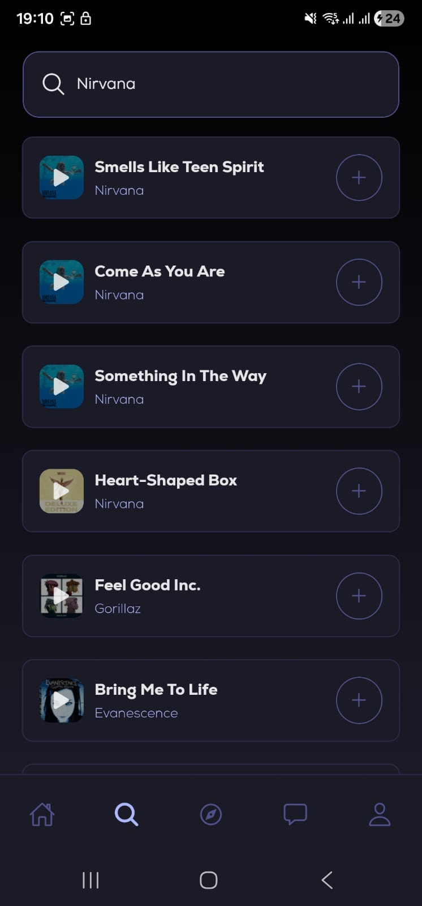
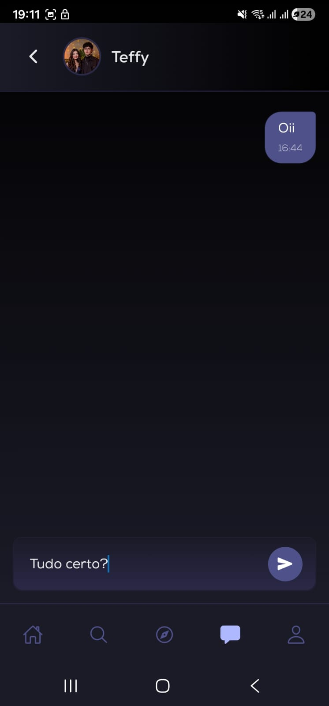

# harmony.

**Onde você se sintoniza com todos!**

Harmony é um aplicativo mobile de rede social musical. Conecte sua conta do Spotify, descubra pessoas com gostos parecidos, explore novas músicas e converse em tempo real com quem compartilha o mesmo som que você.

---

## Como funciona

O Harmony utiliza seus dados do Spotify (músicas curtidas, artistas favoritos, gêneros) para criar um perfil musical único. A partir disso, o app recomenda outros usuários com compatibilidade musical e sugere novas músicas baseadas no seu gosto.

**Fluxo básico:**
1. Crie sua conta e vincule seu Spotify
2. Explore seu feed com curtidas recentes e recomendações
3. Descubra pessoas e músicas com o sistema de swipe
4. Deu match? Converse em tempo real pelo chat
5. Personalize seu perfil com foto, bio e "tocando agora"

---

## Screenshots

| Login | Home | Perfil |
|:---:|:---:|:---:|
|  |  |  |

| Descobrir músicas | Swipe | Busca |
|:---:|:---:|:---:|
|  |  |  |

| Conversas | Chat | Chat |
|:---:|:---:|:---:|
|  |  |  |

---

## Funcionalidades

- **Feed personalizado** - Suas curtidas recentes e músicas recomendadas pelo Spotify
- **Descoberta por swipe** - Deslize para curtir ou pular músicas e pessoas, estilo Tinder
- **Compatibilidade musical** - Score de compatibilidade baseado nos seus artistas e gêneros
- **Match e chat** - Quando dois usuários se curtem, um match é criado e o chat é liberado
- **Chat em tempo real** - Mensagens instantâneas via WebSocket
- **Preview de músicas** - Ouça um trecho de 30 segundos direto no app
- **Busca de músicas** - Pesquise qualquer música do catálogo do Spotify
- **Tocando agora** - Defina uma música como destaque no seu perfil
- **Perfil completo** - Foto, bio, top artistas, top gêneros, estatísticas

---

## Tecnologias

### Mobile (este repositório)
- **React Native** com **Expo** (SDK 53)
- **TypeScript**
- **React Navigation** para navegação
- **React Context API** para gerenciamento de estado
- **Axios** para requisições HTTP
- **Microsoft SignalR** para WebSocket (chat em tempo real)
- **Expo AV** para reprodução de áudio
- **React Native Reanimated** para animações

### Backend (repositório separado)
- **C# / ASP.NET Core** Web API rodando na nuvem
- **SignalR** para comunicação em tempo real
- **Integração com Spotify Web API** para dados musicais
- Hospedado no **Render.com**

---

## Limitação importante - Spotify API

O Harmony depende da API do Spotify para funcionar. Atualmente, o Spotify exige que aplicativos passem por um processo de **Extended Quota Mode** para serem disponibilizados publicamente, e os requisitos para esse processo torna inviável a passagem do Harmony para produção.

Por esse motivo:
- **Não há APK disponível para download público** no momento
- Futuramente, pretendo disponibilizar uma **conta de teste** para que qualquer pessoa possa experimentar o app sem precisar vincular o próprio Spotify

---

## Autor

Desenvolvido como projeto acadêmico no **IFSul** (Instituto Federal Sul-rio-grandense).

---

## Licença

Este projeto é apenas para fins educacionais e de demonstração.
