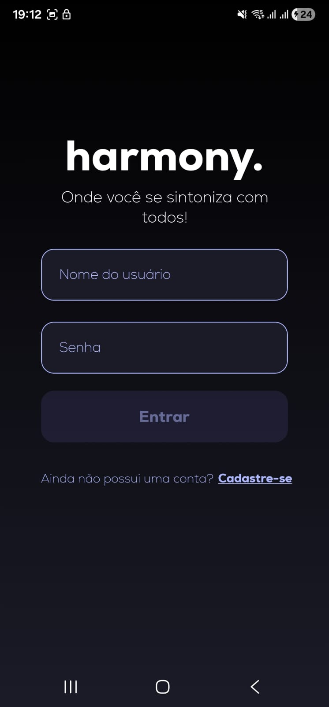
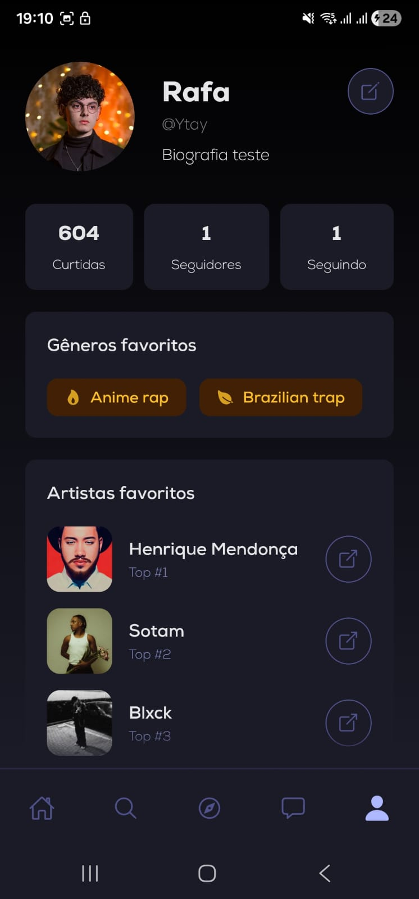

# harmony.

**Onde você se sintoniza com todos!**

Harmony é uma rede social musical mobile integrada ao Spotify. Descubra pessoas com gostos musicais parecidos, ouça prévias, dê match por afinidade sonora e converse em tempo real.

Este repositório reúne tanto o **aplicativo mobile (React Native + Expo)** na raiz quanto a **API REST + WebSocket (C# / ASP.NET Core 9 + SignalR + MongoDB)** em [`backend/`](./backend).

---

## Como funciona

O Harmony utiliza dados da conta do Spotify (músicas curtidas, artistas favoritos e gêneros) para montar o perfil musical de cada usuário, calcular compatibilidade e sugerir novas músicas e conexões.

**Fluxo básico:**
1. Crie sua conta e vincule seu Spotify
2. Explore seu feed com curtidas recentes e recomendações
3. Descubra pessoas e músicas com o sistema de swipe
4. Deu match? Converse em tempo real pelo chat (SignalR)
5. Personalize seu perfil com foto, bio e "tocando agora"

---

## Screenshots

<div align="center">

| Login | Home | Perfil |
|:---:|:---:|:---:|
|  |  |  |

| Descobrir músicas | Swipe | Busca |
|:---:|:---:|:---:|
|  |  |  |

| Conversas | Chat | Chat |
|:---:|:---:|:---:|
|  |  |  |

</div>

---

## Estrutura do repositório

```text
harmony/
├── api/                 # Cliente HTTP (Axios) do aplicativo mobile
├── assets/              # Ícones, imagens e screenshots do app
├── components/          # Componentes reutilizáveis em React Native
├── context/             # Estado global e autenticação (React Context)
├── navigation/          # Fluxos de navegação (React Navigation)
├── screens/             # Telas do aplicativo mobile
├── types/               # Tipagens compartilhadas do frontend
└── backend/             # API em C# / ASP.NET Core 9 + SignalR + MongoDB
    ├── Controllers/     # Endpoints REST (Auth, Profile, Discovery, Music, Chat)
    ├── Hubs/            # Hub SignalR para mensagens em tempo real (ChatHub)
    ├── Services/        # Regras de negócio, compatibilidade, JWT e Spotify API
    ├── Data/ & Models/  # Contexto e modelos do MongoDB
    └── Dockerfile       # Build multi-stage para deploy em container
```

---

## Stack

### Mobile (raiz)
- **React Native** com **Expo** (SDK 53) e **TypeScript**
- **React Navigation** & **React Context API**
- **Axios** para consumo da API REST
- **Microsoft SignalR** (`@microsoft/signalr`) para chat em tempo real
- **Expo AV** para reprodução de prévias de 30 segundos
- **React Native Reanimated** para gestos e transições de swipe

### API ([`backend/`](./backend))
- **C# / ASP.NET Core 9** Web API
- **ASP.NET Core SignalR** para WebSockets em tempo real
- **MongoDB** para persistência de usuários, perfis, matches e mensagens
- **Autenticação JWT** (`Microsoft.AspNetCore.Authentication.JwtBearer`)
- **Spotify Web API** (OAuth, top faixas/artistas, busca e recomendações)
- **Docker** (container pronto para deploy)

---

## Como executar localmente

### 1. API (`backend/`)

Configure as variáveis/user-secrets necessárias (`ConnectionStrings:MongoConnection`, `MongoDatabaseName`, `JwtSettings:Secret`, `SpotifySettings:ClientId`, `SpotifySettings:ClientSecret`, `SpotifySettings:RedirectUri`) e execute:

```bash
cd backend
dotnet restore
dotnet run
```

### 2. Aplicativo mobile (raiz)

Defina `EXPO_PUBLIC_API_URL` apontando para a URL da API e inicie o Expo:

```bash
npm install
npx expo start
```

---

## Observação sobre a API do Spotify

O Spotify exige aprovação em **Extended Quota Mode** para liberar acesso público irrestrito a contas externas, o que inviabiliza a distribuição pública de um APK conectado à API em produção. Por isso, o projeto é mantido para fins acadêmicos e de portfólio (desenvolvido originalmente no **IFSul — Instituto Federal Sul-rio-grandense**).
